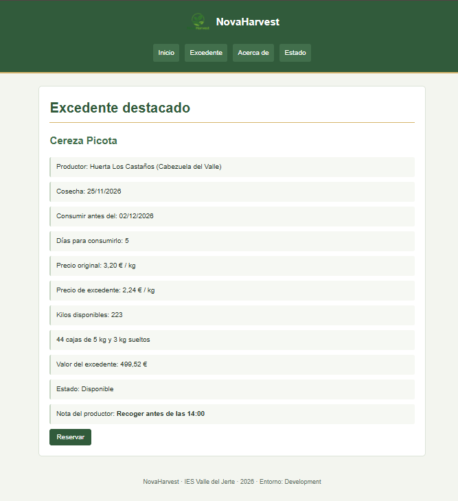
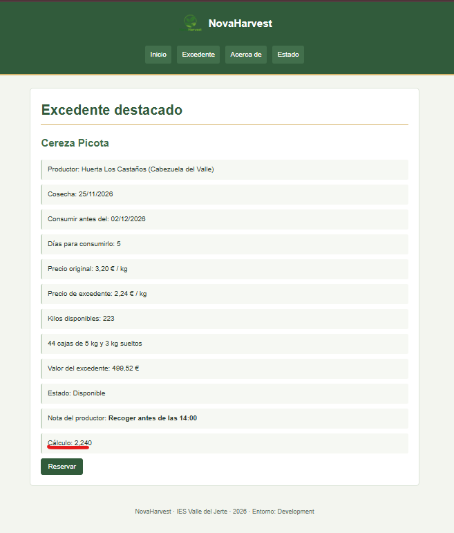
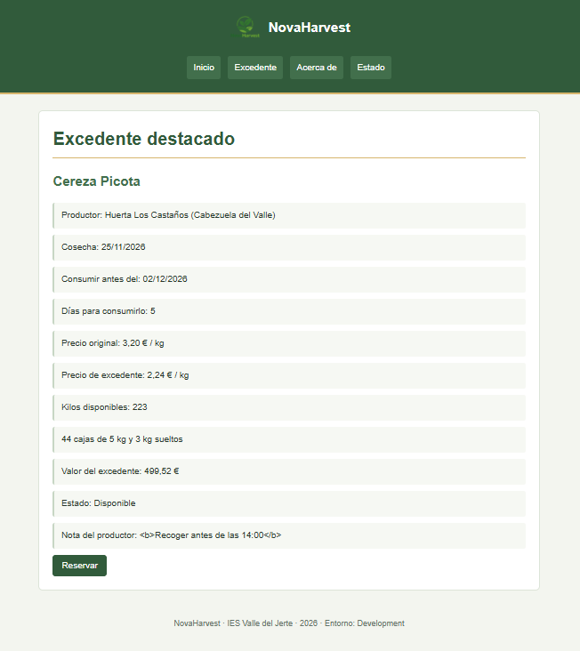
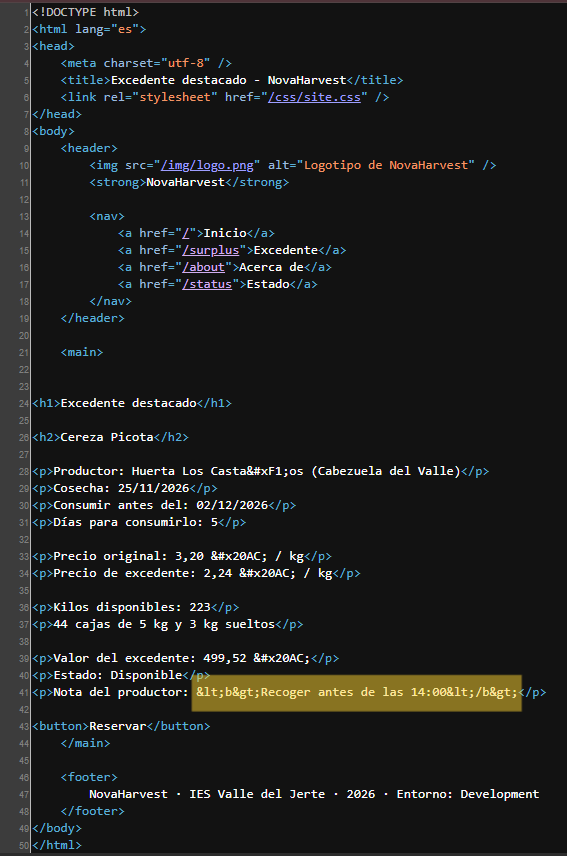
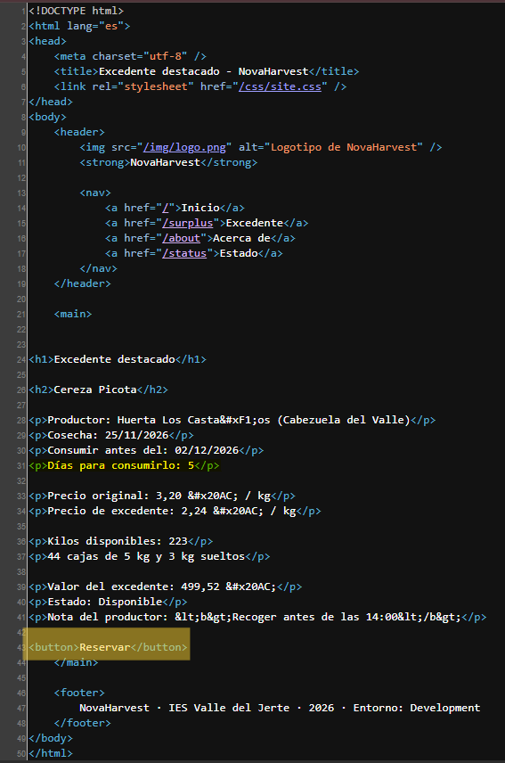
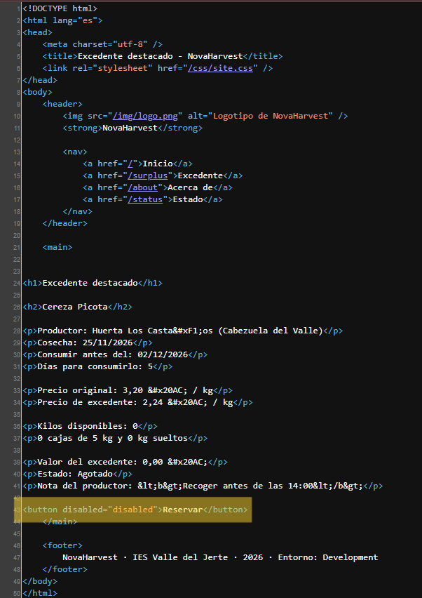
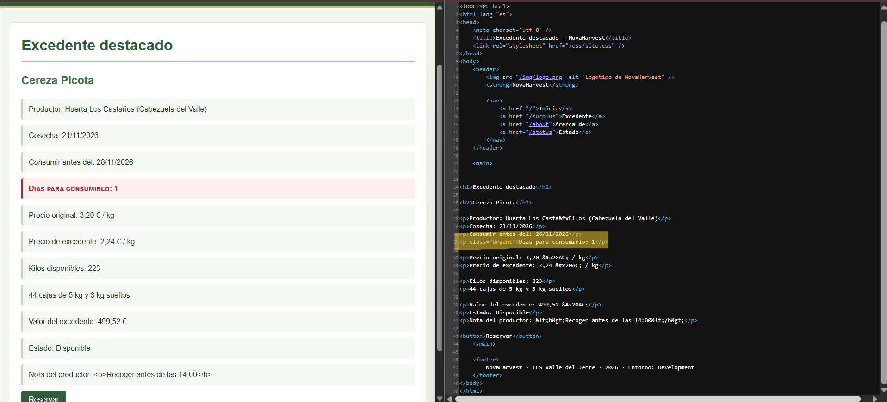
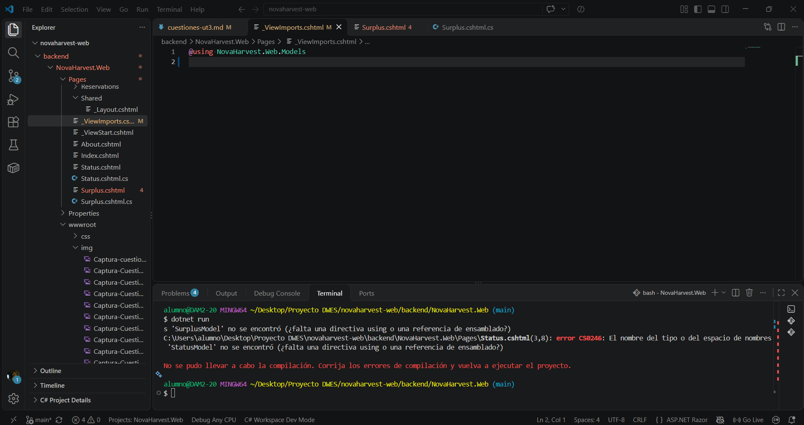
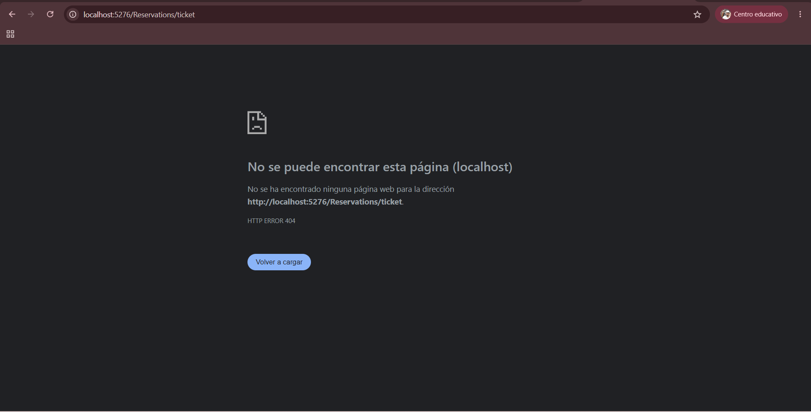
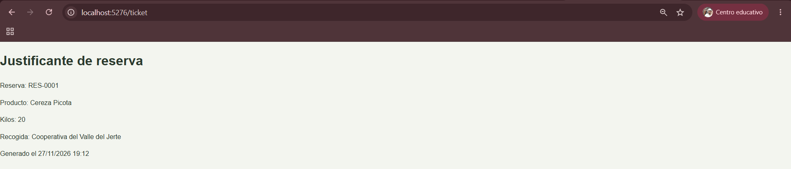

# Cuestiones UT3 — NovaHarvest

## 1. De `.cshtml` a HTML
Al compilar NovaHarvest, Razor transforma las páginas `.cshtml` en código C# compilado. Cuando se solicita una página, ASP.NET Core ejecuta ese código en el servidor y devuelve HTML al navegador.

`WriteLiteral` escribe el HTML y el texto fijo de la página, como el encabezado «Estado del servidor» y la etiqueta «Fecha y hora del servidor».

Mientras que `Write` escribe el resultado de una expresión C# de Razor, como `@Model.ServerTime.ToString("dd/MM/yyyy HH:mm:ss")`, que muestra la fecha y hora calculadas en el servidor.

## 2. Tecnologías
La línea del precio de nuestra página utiliza Razor: `@Model.DiscountedPrice.ToString("C")`. En PHP se puede escribir `<?= $discountedPrice ?>` y en ASP clásico `<%= discountedPrice %>`. Esas dos sintaxis usan delimitadores; Razor empieza con @ y detecta el final de la expresión por la sintaxis de C#.

En UT2 las páginas se generaban con `MapGet` y cadenas HTML en `Program.cs`. Ahora cada página tiene su propio `.cshtml` y `Program.cs` registra Razor Pages con `MapRazorPages()`.

.png)

.png)

## 3. Etiquetas de código
En `Surplus.cshtml`, `@Model.Surplus.Product` es una expresión implícita y muestra el producto. `@(Model.DiscountedPrice.ToString("C"))` es una expresión explícita. El bloque `@{ ViewData["Title"] = "Excedente destacado"; }` establece el título y no añade texto al cuerpo. `@@novaharvest` muestra una arroba literal y `@* comentario *@` no aparece en el HTML.

`info@novaharvest.es` se interpreta como texto de una dirección de correo; @novaharvest podría interpretarse como código Razor, por eso se usa `@@` para mostrar la arroba literal.

## 4. Sintaxis

Si se escribe una propiedad que no existe, como `@Model.SurplusPrize`, la compilación falla. En nuestro código el precio rebajado se llama `DiscountedPrice`, mientras que el enunciado menciona `SurplusPrice`; hay que tener presente esa diferencia al hacer la prueba. En `Model.Surplus.PricePerKg * 0.7m`, Razor evalúa la expresión de la propiedad, pero la multiplicación no queda incluida como una sola expresión.

Para calcular toda la operación se escribe `@(Model.Surplus.PricePerKg * 0.7m)`. Ambos cambios son temporales y después hay que restaurar el código.

## 5. Efectos en el documento
La nota inicial contiene `<b>Recoger antes de las 14:00</b>`. Razor la codifica cuando muestra `@Model.ProducerNote`, por lo que las etiquetas se ven como texto y no aplican negrita. No conviene usar `Html.Raw` con texto de usuarios, porque el navegador podría interpretar ese contenido como HTML.

En el escenario A, el elemento de días no lleva `class` y el botón no lleva `disabled`. En el C no hay `class`, pero el botón está desactivado. En el D, los días llevan `class="urgent"` y el botón sigue habilitado.

## 6. Directivas
| Directiva o fichero | Función en NovaHarvest |
|---|---|
| `@page` | Declara una página Razor. |
| `@page "/ticket"` | Define la ruta `/ticket`. |
| `@model` | Conecta la vista con su `PageModel`. |
| `@using` | Permite utilizar tipos de otro espacio de nombres. |
| `@namespace` | Define el espacio de nombres de las páginas generadas. |
| `@inject` | Permite recibir un servicio, como el entorno de ejecución. |
| `_ViewStart.cshtml` | Establece el layout predeterminado. |
| `Layout = null;` | Evita aplicar el layout a `Ticket.cshtml`. |

Si quitamos `@namespace` de `_ViewImports.cshtml`, la compilación puede fallar porque las páginas generadas no encuentran sus modelos en el espacio de nombres esperado. `/reservations/ticket` devuelve 404 porque la página declara expresamente la ruta `/ticket`.

